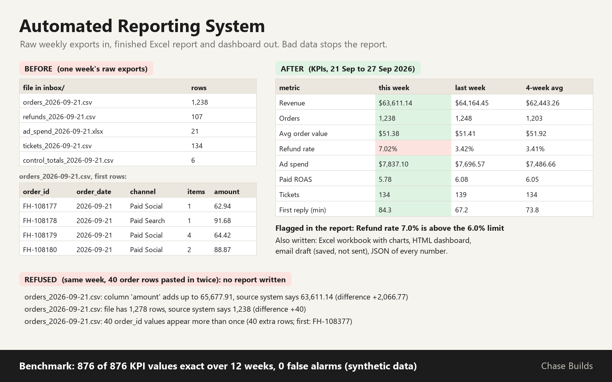

# automated-reporting-system

[](https://github.com/chasebuilds/automated-reporting-system/actions/workflows/ci.yml)  [](LICENSE)

One command turns a folder of raw weekly exports into a finished Excel report and an HTML dashboard, and refuses to publish anything if the data is bad.



## Measured result

From [BENCHMARK.md](BENCHMARK.md), which the benchmark script writes from a real run on seeded synthetic data:

| Measure | Result |
|---|---|
| KPI values matching known truth exactly | 876 of 876, across 12 weeks |
| Planted data faults caught, from the exports alone | 17 of 18 |
| Planted data faults caught, with a control totals file | 18 of 18 |
| False alarms on the 12 clean weeks | 0 |
| Outputs byte-identical on a second run | 4 of 4 files |

The one miss is listed, not hidden: a random 3% loss of order rows looks like a normal week, so nothing in the export gives it away. It is caught only when the source system's own totals are supplied to reconcile against. See [LIMITATIONS.md](LIMITATIONS.md). Run time per week is in the benchmark file, since it depends on the machine.

## Before and after

| Before: what lands in `inbox/` each week | After: what one command writes |
|---|---|
| [`orders_2026-09-21.csv`](samples/inbox/orders_2026-09-21.csv), 1,238 rows | [`weekly_report_2026-09-21.xlsx`](samples/output/2026-09-21/weekly_report_2026-09-21.xlsx): KPI tiles, 4 native Excel charts, 7 detail sheets |
| [`refunds_2026-09-21.csv`](samples/inbox/refunds_2026-09-21.csv), 107 rows | [`dashboard_2026-09-21.html`](samples/output/2026-09-21/dashboard_2026-09-21.html): one self-contained file, works on a phone, light and dark |
| [`ad_spend_2026-09-21.xlsx`](samples/inbox/ad_spend_2026-09-21.xlsx), 21 rows | [`kpis_2026-09-21.json`](samples/output/2026-09-21/kpis_2026-09-21.json): every number, for other tools |
| [`tickets_2026-09-21.csv`](samples/inbox/tickets_2026-09-21.csv), 134 rows | [`weekly_report_2026-09-21.eml`](samples/outbox/weekly_report_2026-09-21.eml): the email, saved, not sent |
| [`control_totals_2026-09-21.csv`](samples/inbox/control_totals_2026-09-21.csv), optional | A copy of every input under `state/archive/`, with its hash in the report |

And when the data is wrong, the after is a refusal. The same week with 40 order rows pasted in twice ([`samples/inbox_bad`](samples/inbox_bad)):

```text
No report for the week of 2026-09-21: 3 data problem(s) must be fixed first.
  orders_2026-09-21.csv: column 'amount' adds up to 65,677.91, source system says 63,611.14 (difference +2,066.77)
  orders_2026-09-21.csv: file has 1,278 rows, source system says 1,238 (difference +40)
  orders_2026-09-21.csv: 40 order_id values appear more than once (40 extra rows; first: FH-108377)
```

Exit code 1, no report file is written, and a short [no-report notice](samples/no_report_example_2026-09-21.eml) is saved for the people who were expecting the report.

## Quick start

Needs Python 3.11 or newer. On macOS or Linux use `.venv/bin/` in place of `.venv\Scripts\`.

```powershell
python -m venv .venv
```

```powershell
.venv\Scripts\pip install -e .
```

```powershell
.venv\Scripts\autoreport run --config samples/report.toml
```

That rebuilds the sample report in `samples/output/` from `samples/inbox/`. The files come out byte-identical to the ones in this repo (checked on Python 3.12, 3.13 and 3.14), so `git status` stays clean.

To watch the gate refuse a bad week:

```powershell
.venv\Scripts\autoreport run --config samples/report.toml --inbox samples/inbox_bad
```

To compare the tool with a report made by hand (one figure in the sample is planted wrong):

```powershell
.venv\Scripts\autoreport compare --config samples/report.toml --period 2026-09-21 --manual samples/manual_report_2026-09-21.csv
```

Other commands: `autoreport check` runs the gate and writes nothing, `autoreport status` lists the weeks already processed, `autoreport run --all` works through every week in the inbox in date order (use it to backfill).

To run the tests and the benchmark:

```powershell
.venv\Scripts\pip install -e ".[dev]"
```

```powershell
.venv\Scripts\pytest
```

```powershell
.venv\Scripts\python -m benchmark.run
```

For an install that is the same next year, use the pinned versions: `pip install -r requirements.lock` before `pip install -e . --no-deps`.

## How it works

Five stages, each written to the run log:

```text
[start    ] Fernhollow Supply Co., week of 2026-09-21, inbox samples/inbox
[ingest   ] orders_2026-09-21.csv: 1,238 rows, all 5 required columns present
[ingest   ] refunds_2026-09-21.csv: 107 rows, all 5 required columns present
[ingest   ] ad_spend_2026-09-21.xlsx: 21 rows, all 4 required columns present
[ingest   ] tickets_2026-09-21.csv: 134 rows, all 4 required columns present
[ingest   ] control_totals_2026-09-21.csv: 6 control totals
[validate ] INFO control_total: control_totals_2026-09-21.csv: 6 control totals from the source system match the files exactly
[validate ] 0 failures, 0 warnings
[transform] orders 1,238, refunds 107, ad_spend 21, tickets 134 rows typed
[kpis     ] revenue 63,611.14, orders 1,238, refund rate 0.0702, paid ROAS 5.78, tickets 134
[render   ] wrote samples/output/2026-09-21/weekly_report_2026-09-21.xlsx (78,185 bytes)
[render   ] wrote samples/output/2026-09-21/dashboard_2026-09-21.html (23,123 bytes)
[render   ] wrote samples/output/2026-09-21/kpis_2026-09-21.json (7,236 bytes)
[deliver  ] wrote samples/outbox/weekly_report_2026-09-21.eml (140,350 bytes)
[deliver  ] dry run: message saved to the outbox, nothing was sent
[state    ] archived 5 input files in samples/state/archive/2026-09-21
[state    ] recorded 4 files and the week's KPIs in samples/state
```

(Stage timing lines are left out above.)

1. **Ingest.** Finds the week's four files by name (`orders_<week start>.csv` and so on, CSV or XLSX), checks each has its required columns, and parses every cell. Money becomes whole cents, so totals carry no rounding drift.
2. **Validate.** The data-quality gate. Checks at two levels:

   | Check | Fail (run stops, no report) | Warn (report written, warning printed in it) |
   |---|---|---|
   | Files | a file is missing, unreadable, or delivered twice | |
   | Columns and values | a required column is missing; a value is blank or not a number or date | |
   | Duplicates | an order, refund or ticket id appears twice | |
   | Negative amounts | any negative amount, spend, item count or response time | |
   | Dates | rows dated outside the week; two or more days with no orders | one day with no orders; a paid channel with no spend row for a day |
   | Row count | 60% or more off the trailing average | 30% or more off the trailing average |
   | Control totals (optional file) | a row count or amount total differs from the source system's figure | |
   | Already processed | the same file content was already used for another week | this week's file changed since it was last run (restated) |
   | Other | orders file has no rows | unknown channel name; a value 25 times the typical one; refunds, spend or tickets file has no rows |

   Every threshold is in the config file.
3. **Transform.** Maps channel labels to the names in the config (`Google Ads` to `Paid Search`), so two exports that name a channel differently still line up.
4. **KPIs.** Revenue, orders, average order value, refund rate, ad spend and return on ad spend by channel, ticket volume and first response time. Each headline number is compared with last week and with the trailing 4-week average. The workbook's `Definitions` sheet states each formula in words.
5. **Render and deliver.** Writes the workbook, the dashboard, a JSON file of the numbers, and an `.eml` message with both attached. The email is a dry run: it is saved to `outbox/` and never sent. This package contains no code that sends mail.

What keeps it safe to run unattended:

- **Same input, same bytes.** Each processed file is recorded by its hash in `state/ledger.json`, and each week's KPIs are stored under that week's date, so a rerun replaces the week and nothing is counted twice.
- **No half-written files.** Everything is rendered in memory, each file is written beside its target and swapped in whole, and state is saved last. A lock file stops two runs from overlapping.
- **Inputs are kept.** Every accepted input file is copied to `state/archive/<week>/`, so a report can be rebuilt after the inbox is overwritten.
- **Silence is not success.** A refused week leaves a no-report notice in the outbox. An optional heartbeat URL (off by default) lets a monitoring service raise the alarm when the scheduled run does not happen at all.

To run it on a schedule, see [docs/scheduling.md](docs/scheduling.md): Windows Task Scheduler, cron and GitHub Actions. To operate it day to day, see [RUNBOOK.md](RUNBOOK.md).

## What a client receives

- The pipeline set up for their exports: column names, channels, thresholds and file names changed to match what their systems produce.
- The Excel workbook each period: a `Summary` sheet with KPI tiles and charts, then `Channels`, `Daily`, `Trend`, `Refunds`, `Support`, `Data Quality` and `Definitions`. Number formats, frozen headers and print setup are done.
- The HTML dashboard: one file, no logins, opens from an email attachment.
- A `Data Quality` sheet in every report listing each warning, each file read, its row count and its hash, so every number can be traced to a file. The first page states the date the data runs through.
- A plain message naming the file and the problem whenever a report is refused.
- A parallel-run comparison against their current hand-made report before it is retired (`autoreport compare`).
- A config file they can edit themselves, a [runbook](RUNBOOK.md), a scheduling guide, and written [maintenance terms](MAINTENANCE.md).

## Limits

It is built around four weekly files with fixed column names, and without a control totals file it cannot catch errors that look like a normal week. Details in [LIMITATIONS.md](LIMITATIONS.md).

All data in this repo is synthetic, made by a seeded generator. The company in the samples is invented.

## License

MIT. See [LICENSE](LICENSE).
